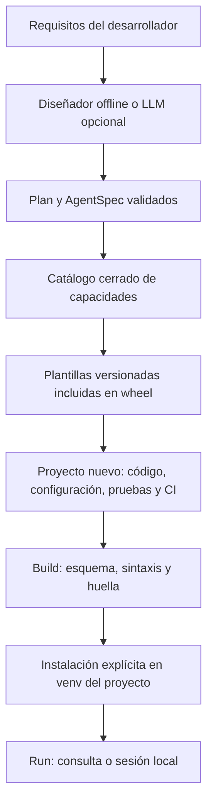

# Instalación y uso detallado

## Instalación global desde este checkout

Requiere Python 3.12. Se recomienda pipx para separar las dependencias de la herramienta.

```console
python -m pip install --user pipx
python -m pipx ensurepath
pipx install --python 3.12 .
agentcraft --version
```

Reabra la terminal si `ensurepath` modifica PATH. Para probar sin cambiar PATH:
`python -m pipx run --spec . agentcraft --help`.

Desde GitHub:

```console
pipx install --python 3.12 "git+https://github.com/juliansantamaria0/agentcraft-forge.git@main"
```

Cuando la distribución esté publicada en PyPI:

```console
pipx install --python 3.12 agentcraft-forge
```

Alternativa en un entorno de Python administrado por usted:
`python -m pip install "git+https://github.com/juliansantamaria0/agentcraft-forge.git@main"`.
Para reproducibilidad, sustituya `main` por un commit verificado o un tag publicado.
En sistemas con Python administrado externamente, prefiera pipx; no fuerce una
instalación sobre el entorno del sistema. Las dependencias de cada agente generado
se instalan en el `.venv` de su proyecto, separado de pipx.

Si ya instaló desde este repositorio, actualice con `pipx reinstall agentcraft-forge`.
Compruebe `agentcraft --version` y `agentcraft doctor`. La instalación desde un wheel
local conserva ese origen en pipx: reinstale desde el nuevo wheel o desde GitHub según
corresponda. No se han publicado distribuciones de esta herramienta en PyPI.

Actualizar la CLI cambia las plantillas para los proyectos nuevos. Los agentes ya
generados conservan su código y sus datos: no se migran ni se sobrescriben al reinstalar.
Para adoptar correcciones en un agente existente, genere una copia en otra carpeta,
compare el código y ejecute sus pruebas antes de integrar los cambios.

## Usarlo desde el mismo chat

Con un asistente que pueda ejecutar herramientas locales, instale el adaptador:

```console
agentcraft doctor
agentcraft install-skill --directory .agents/skills
```

Ese comando instala la habilidad en el workspace. Para Codex global en PowerShell:

```powershell
agentcraft install-skill --directory "$HOME/.codex/skills"
```

Para otros clientes elija su directorio de habilidades configurado; el descubrimiento
y la recarga dependen del cliente. El instalador no sobrescribe una habilidad distinta.
No modifica la configuración global al instalar el paquete: la ubicación se elige
explícitamente. Puede pedir al asistente que ejecute estos pasos por usted.

Después, escriba: «Usa AgentCraft para crear mi agente de gastos en esta carpeta;
comprueba su origen, instala el runtime y ejecuta sus pruebas». El adaptador exige
invocar la CLI y comprobar sus resultados antes de atribuirle un proyecto.

## Gastos personales y compromisos: motores sin API de IA

```console
agentcraft init --name mis-gastos --purpose "Registrar gastos personales y consultar resúmenes" --kind expenses --yes --json
agentcraft build --project mis-gastos --install
agentcraft inspect --project mis-gastos
agentcraft run --project mis-gastos --message "Gasté 15k en transporte"
```

El último comando devuelve una **propuesta sin escribir**. Para registrarla, el chat
envía una solicitud JSON explícita mediante invoke y espera el comprobante del motor.
Las consultas de lenguaje libre pueden ser interpretadas por el asistente; el motor
valida la solicitud antes de guardar. No es un LLM embebido en el parser.

| Plantilla | Capacidades de dominio |
|---|---|
| expenses | COP en enteros, categorías neutrales, presupuestos por mes, registros múltiples atómicos, anulaciones, resúmenes e IDs idempotentes |
| audit | Exports WhatsApp y journal, responsable declarado, fuentes y fechas, progreso reciente, candidatos revisables, snapshots y aplicación con backup |

Cada proyecto incluye una habilidad local, agentcraft.json y agentcraft.provenance.json.
`inspect` distingue modificaciones, build fresco y ausencia de pruebas de comportamiento.
La evidencia es una huella local, no una firma de autoría.

Vea [el flujo completo y las solicitudes JSON](chat-workflow.md).
No hay conector WhatsApp operativo ni importación automática de bases de otros proyectos.
No se crean datos personales ficticios como si fueran del usuario.

## Inicio en tres comandos

```console
agentcraft init
agentcraft build --project my-agent
agentcraft run --project my-agent --dry-run
```

El asistente pregunta nombre, propósito y arquitectura; muestra el plan antes de generar.
El modo predeterminado usa reglas locales y plantillas, sin credenciales. Para diseño
asistido por IA, instale el extra `ai`, configure `OPENAI_API_KEY` en el entorno y use
`agentcraft init --ai`. El propósito se envía al proveedor solo en ese modo.

Para instalar el diseñador desde este checkout use `pipx install --python 3.12 ".[ai]"`.
Si ya instaló la edición base, puede agregarlo con
`pipx inject agentcraft-forge "langchain-openai==1.7.2" "python-dotenv>=1.2.2,<2"`.
Configure `OPENAI_API_KEY` mediante su gestor de secretos o el entorno de la sesión;
`AGENTCRAFT_DESIGN_MODEL` permite seleccionar el modelo del diseñador. Los modelos
del agente generado se configuran por separado en su propio `.env`.

## Generación no interactiva

```console
agentcraft init --name support-rag --kind rag --purpose "Responder preguntas sobre documentos de soporte autorizados" --yes
agentcraft build --project support-rag --install
```

Copie `support-rag/.env.example` a `support-rag/.env` y configure la clave y los modelos.
Después:

```console
agentcraft run --project support-rag --ingest support-rag/data/sample
agentcraft run --project support-rag --message "¿Cuánto tarda un ticket de prioridad alta?"
agentcraft run --project support-rag
```

El último comando abre una sesión. Escriba `salir` para terminar. El contexto reciente
se mantiene en memoria y no se conserva entre sesiones. La ingestión requiere un
snapshot nuevo; si la colección existe, utilice otro nombre y promuévalo tras evaluarlo.

### Agente con herramientas

```console
agentcraft init --name api-agent --kind tools --purpose "Consultar información de repositorios y clima con APIs de lectura" --yes
agentcraft build --project api-agent --install
# Configurar api-agent/.env antes de usar el modelo.
agentcraft run --project api-agent --message "Consulta qdrant/qdrant y el clima en Bogota"
```

### Sistema multiagente

```console
agentcraft init --name design-team --kind multi --purpose "Analizar requisitos, diseñar una arquitectura y revisar sus riesgos" --yes
agentcraft build --project design-team --install
# Configurar design-team/.env antes de usar el modelo.
agentcraft run --project design-team --message "Propón módulos y pruebas de aceptación para un asistente documental"
```

## Qué significa build

`agentcraft build` valida el manifiesto, archivos requeridos, metadatos, entry point
y sintaxis Python; escribe una huella del código. No importa ni ejecuta los módulos
del agente, no instala dependencias y no llama al modelo. No es compilación nativa.
Si el código cambia, `run` exige volver a construir.

`build --install` crea un venv e instala el proyecto con pip. Puede ejecutar el backend
de empaquetado, por lo que debe usarse solo con proyectos locales de confianza.
El venv aísla dependencias, no los permisos del proceso. Genere y versione un lock
del agente antes de un despliegue reproducible; `uv.lock` de AgentCraft solo fija la CLI.

## Arquitectura del meta-agente



El LLM selecciona arquitectura y capacidades, no escribe Python arbitrario para que
el generador lo ejecute. Nuevas herramientas se incorporan al catálogo y a las
plantillas mediante cambios de código revisados. La versión inicial usa proveedores
OpenAI a través del adaptador LangChain; otros requieren implementar adaptadores.

## Árbol del repositorio

```text
agentcraft-forge/
├── .github/workflows/{ci,publish}.yml
├── {design,implementation,distribution,sources}.md
├── scripts/{check_version,wheel_smoke}.py
├── src/agentcraft_forge/
│   ├── __init__.py / __main__.py
│   ├── cli.py             # Typer + Rich
│   ├── schema.py          # Plan y AgentSpec
│   ├── planner.py         # Reglas o diseñador LLM
│   ├── generator.py       # Recursos → proyecto nuevo
│   ├── project.py         # build, huella, venv y run
│   └── templates/
│       ├── common/*.j2    # pyproject, README, CI, Docker y runner
│       └── runtime/       # Código probado de RAG, ReAct y CrewAI
├── tests/
├── pyproject.toml
├── uv.lock
├── MANIFEST.in
├── CHANGELOG.md
├── SECURITY.md
└── LICENSE
```

## Desarrollo y contribución

```console
python -m pip install uv==0.13.4
uv sync --locked --all-extras --group dev
uv run --locked pytest
uv run --locked ruff check .
uv run --locked black --check .
uv build --no-sources
uv run --locked twine check dist/*
```

Use PRs con el problema, cambio y pruebas. Nuevas plantillas deben incluir pruebas
desde el wheel instalado: una instalación editable puede ocultar recursos faltantes.
No incluya secretos en fixtures, notebooks o incidencias.

Consulte [la evidencia local y sus límites](../VALIDATION.md) antes de interpretar las
pruebas de empaquetado como validación de los modelos o de un despliegue.

## Publicación

`publish.yml` valida una versión ya declarada, construye y prueba el wheel, crea el
tag sobre el commit validado, publica con PyPI Trusted Publishing y crea la GitHub
Release. Necesita un remoto y un publisher PyPI configurados por el mantenedor.
Vea [distribución](distribution.md) para el procedimiento exacto.

## Límites de producción

Las plantillas aportan código modular, pruebas básicas, límites y contratos. Cada
despliegue requiere identidad, evaluación con datos propios, presupuesto, operación,
gestión de secretos, observabilidad y aceptación del riesgo. AST válido o un venv no
son una auditoría de seguridad. Consulte [diseño y amenazas](design.md).

